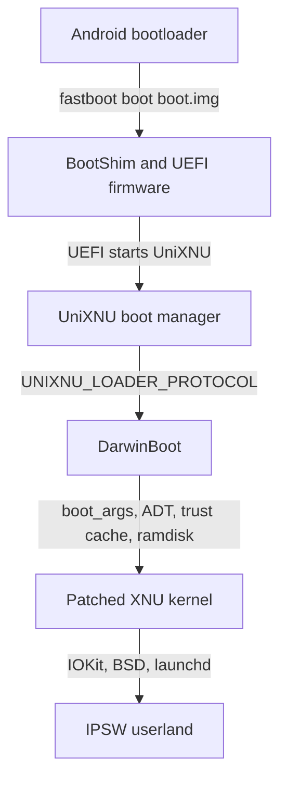

# Welcome

UniXNU is a general UEFI environment and driver loading system, similar to OpenCore. A common UEFI layer starts on the device, loads the drivers the device repository selects and boots the OS. UniXNU applies that model to non-Apple ARM64 hardware: it boots iOS and macOS from the device's own UEFI firmware.

## Architecture

The stack has six layers. Each layer has a repository, a build output and a handoff to the next layer.

| Layer | Source | Output | Hands over |
| --- | --- | --- | --- |
| 1. Boot image | Device repository, `./unixnu bootimg` | Android boot image: BootShim, firmware volume, device tree, payload ramdisk | The stock bootloader jumps to BootShim |
| 2. UEFI firmware | `uefi-<device>` (Mu-Silicium) | `SILICIUM_UEFI.fd` | Graphics, input, block and file system services |
| 3. Boot manager | UniXNU `package/UniXNUPkg` | `UniXNU.efi` | Loads drivers, ACPI tables, kits and the device tree, then starts the selected entry |
| 4. XNU loader | DarwinBoot | UEFI driver | Copies the kernel, ADT, trust cache and ramdisk, builds `boot_args`, enters the kernel |
| 5. Kernel | Pinned XNU source, ordered patch series, prelink | `kernel.macho` and its ADT | Native drivers and the original kexts, then launchd |
| 6. Userland | Target IPSW | `OS` and `SystemOS` images in userdata | iOS or macOS user space |

Shared code lives in UniXNU and its component repositories. SoC repositories add platform support, and device repositories add board configuration, drivers and packaging. See the [boot chain](/concepts/boot-chain) for the handoff details.

## Next

Follow [Port a device](/porting/steps) in order.
