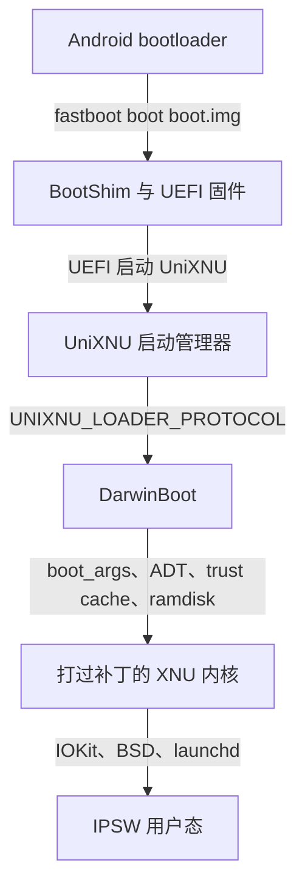

# 欢迎

UniXNU 类似 OpenCore，是通用的 UEFI 环境和驱动加载系统：统一的 UEFI 层在设备上启动，加载设备仓库所选的驱动，再启动系统。UniXNU 把这套方式用在非 Apple ARM64 硬件上，从设备自己的 UEFI 固件启动 iOS 和 macOS。

## 架构

整个栈分为六层。每一层都有对应的仓库、构建产物和交给下一层的内容。

| 层 | 来源 | 产物 | 交接 |
| --- | --- | --- | --- |
| 1. 启动镜像 | 设备仓库，`./unixnu bootimg` | Android 启动镜像：BootShim、固件卷、设备树、payload ramdisk | 原厂 bootloader 跳到 BootShim |
| 2. UEFI 固件 | `uefi-<device>`（Mu-Silicium） | `SILICIUM_UEFI.fd` | 图形、输入、块设备和文件系统服务 |
| 3. 启动管理器 | UniXNU `package/UniXNUPkg` | `UniXNU.efi` | 加载驱动、ACPI 表、kit 和设备树，再启动所选条目 |
| 4. XNU 加载器 | DarwinBoot | UEFI 驱动 | 复制内核、ADT、trust cache 和 ramdisk，构建 `boot_args`，进入内核 |
| 5. 内核 | 固定版本的 XNU 源码、有序补丁系列、prelink | `kernel.macho` 及其 ADT | 原生驱动和原版 kext，然后是 launchd |
| 6. 用户态 | 目标 IPSW | userdata 中的 `OS` 和 `SystemOS` 镜像 | iOS 或 macOS 用户空间 |

共享代码在 UniXNU 及其组件仓库中。SoC 仓库提供平台支持，设备仓库提供板级配置、驱动和打包。各层交接细节见[启动链](/zh/concepts/boot-chain)。

## 下一步

按顺序阅读[移植设备](/zh/porting/steps)。
